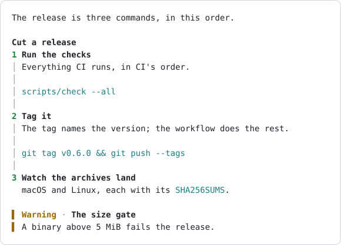
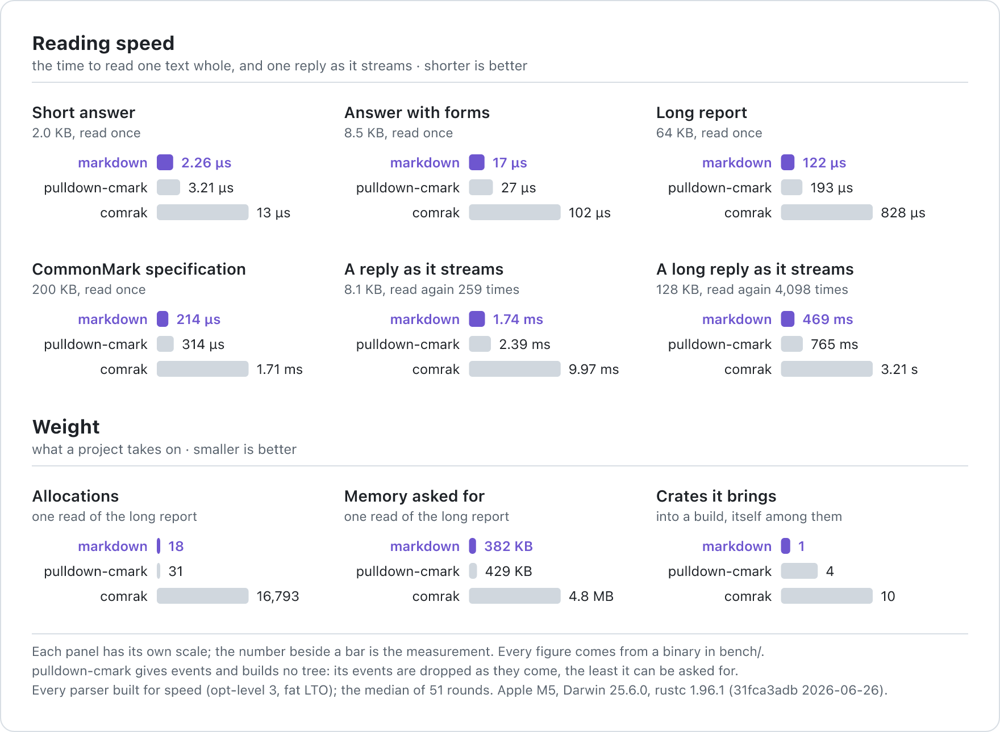
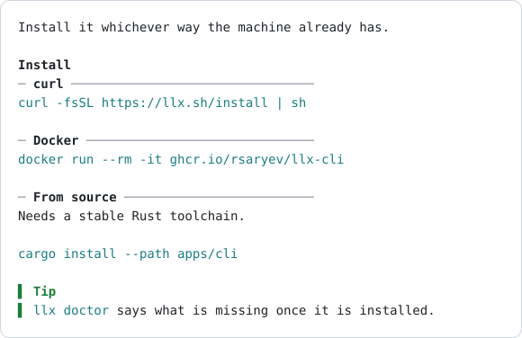
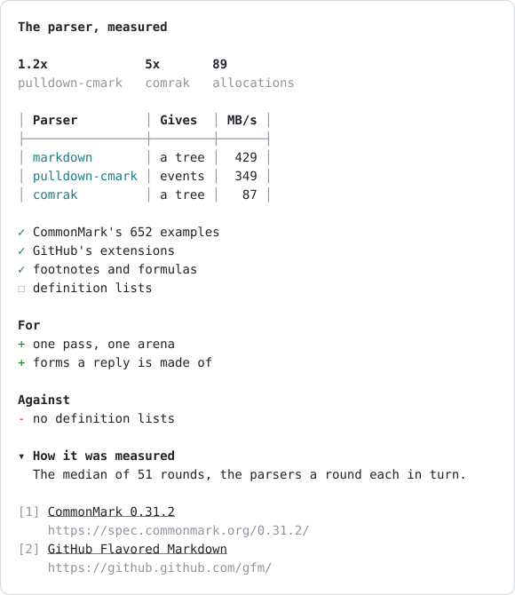
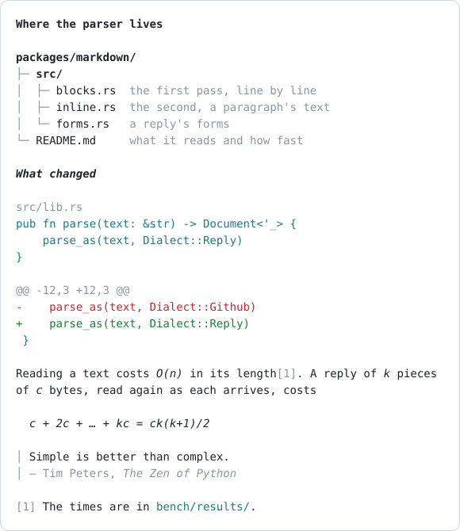

<h1 align="center">markdown</h1>

<p align="center">
  <strong>The Markdown a model writes, read into a tree</strong><br>
  All of CommonMark · GitHub's extensions · the forms of a reply · 0 dependencies · 429 MB/s
</p>

<p align="center">
  <a href="#use">Use</a> ·
  <a href="#the-forms-of-a-reply">Forms</a> ·
  <a href="#telling-the-model">Prompt</a> ·
  <a href="#what-it-reads">What it reads</a> ·
  <a href="#measured">Measured</a> ·
  <a href="#how-it-is-made">How it is made</a>
</p>

<p align="center">
  <picture>
    <source media="(prefers-color-scheme: dark)" srcset="assets/steps-dark.svg">
    
  </picture>
</p>

A Rust parser for what a language model answers with: all of CommonMark, GitHub's tables,
strikethrough, task lists and bare links, and the forms a reply is made of (a callout, steps,
tabs, figures, the case for and against, a folded section, sources). Any text is a document:
nothing fails, and a reply cut mid-stream reads as far as it goes.

It is what `llx` draws a model's answer from (`apps/tui/src/markdown.rs`); the pictures here are
that renderer's rows, written as SVG by `bench/src/bin/shots.rs` from the texts in
`bench/shots/`.

## Why

- **Fast.** It builds its tree 1.2 times as fast as `pulldown-cmark` pulls its events and 5
  times as fast as `comrak` builds its own: 429 MB/s against 349 and 87. A 64 KB report is read
  in 122 µs.
- **Made for a stream.** An interface reads the whole reply again as each piece of it arrives.
  A 128 KB reply read again 4,098 times takes 0.47 s here, 0.77 s with `pulldown-cmark` and
  3.2 s with `comrak`; its slowest single read is 0.35 ms.
- **Light.** No dependency at all: one crate in a build, where `pulldown-cmark` brings 4 and
  `comrak` 10. That 64 KB report costs 18 allocations, against 31 and 16,793.
- **Linear.** Time and memory grow with the text, whatever it is: each of 19 texts built to be
  slow costs 3.2 to 5.8 times as much at four times the size, never sixteen.
- **The forms of a reply.** Steps, tabs, figures and sources are in the tree as what they are,
  not as a quote and a list, and the text that teaches a model to write them comes with the
  parser.
- **Whole.** Every one of CommonMark's 652 examples reads as the specification says.

<p align="center">
  <picture>
    <source media="(prefers-color-scheme: dark)" srcset="assets/compare-dark.png">
    
  </picture>
</p>

How these are measured, and where the lead is small, is under [Measured](#measured).

## Use

```rust
use markdown::{Callout, Kind, parse};

let doc = parse("> [!WARNING] Downtime\n> The migration locks the table.\n\n1. **Stop** the writers\n");
let mut blocks = doc.blocks();

let callout = blocks.next().unwrap();
assert_eq!(callout.kind(), Kind::Callout(Callout::Warning));
assert_eq!(callout.title(), "Downtime");

let list = blocks.next().unwrap();
assert_eq!(list.kind(), Kind::List { ordered: true, tight: true });
let strong = list.first().and_then(|item| item.first()).and_then(|text| text.first()).unwrap();
assert_eq!(strong.kind(), Kind::Strong);
assert_eq!(strong.first().unwrap().text(), "Stop");
```

- `parse(text)`: the text as a reply. `parse_as(text, dialect)`: `Dialect::CommonMark` (the
  specification and nothing else), `Dialect::Github` (with its tables, strikethrough, task lists
  and bare links), `Dialect::Reply` (with the forms too).
- `Document`: `root()`, `blocks()`, and `into_owned()` for a caller that cannot keep the source.
- `Node`, a place in the tree, `Copy`: its `kind()`, and what that kind has: `text()` (a text's,
  a code span's or block's, an HTML block's), `info()` (what follows a fence), `dest()` and
  `title()` (a link's or an image's; `title()` is a form's title too, and a tab's label),
  `start()` (an ordered list's first number), `aligns()` (a table's columns), then
  `children()`, `first()` and `next()`.
- `Kind` is matched exhaustively: a renderer that forgets a node does not compile.

## The forms of a reply

A form is a quote whose first line is a marker. It is asked for by that marker and never
guessed; one with nothing it can take stays the quote it was written as, and in any other
Markdown reader the whole thing is a quote and a list, still readable.

| Marker | What it takes | What it is |
| --- | --- | --- |
| `> [!NOTE]`, `[!TIP]`, `[!IMPORTANT]`, `[!WARNING]`, `[!CAUTION]` | the quote | a callout (GitHub's alerts); the rest of the marker's line its title |
| `> [!STEPS] title` | the list after it | stages in order |
| `> [!TABS] title` | the headings after it, up to a rule or a shallower heading | variants side by side, each heading a tab's label |
| `> [!STATS]` | the list after it | headline figures |
| `> [!PROS]`, `> [!CONS]` | the list after it | the case for and against |
| `> [!DETAILS] title` | the quote | secondary material under its title |
| `> [!SOURCES]` | the list after it | the pages a reply draws on |

What a form takes may be quoted with it or follow it unquoted, a blank line between or none, and
forms nest (a tab may hold steps):

````markdown
> [!STEPS] Cut a release
> 1. **Run the checks**
>    Everything CI runs, in CI's order.
> 2. **Tag it**

> [!TABS] Install
> #### curl
> ```sh
> curl -fsSL https://llx.sh/install | sh
> ```
> #### Docker
> ```sh
> docker run --rm -it ghcr.io/rsaryev/localix-cli
> ```
````

<picture>
  <source media="(prefers-color-scheme: dark)" srcset="assets/tabs-dark.svg">
  
</picture>

A terminal folds nothing and switches nothing: tabs are drawn one under another, each under a
rule that holds its label, and a folded section under its title. The tree says only what a form
is; how it is shown is the renderer's. llx's gives a table's columns room by what they hold and
rules its rows apart when they hold long text, stands a task's mark where its bullet would,
puts figures side by side, each number over what it counts (a list where no row holds them),
gives a step's name and a source's address a row of their own, and keeps a code span on one row
where a row holds it.

<picture>
  <source media="(prefers-color-scheme: dark)" srcset="assets/report-dark.svg">
  
</picture>

What is not a form is drawn as what it is too: a fence that names its file (` ```rust src/lib.rs `,
or `title="…"`) under the name, a `diff` by what its lines add and take away, a ` ```tree ` fence
as a file tree, what is said of the names in one column; a formula as the Unicode a terminal has
(`\frac{ck(k+1)}{2}` is `ck(k+1)/2`, `x^2` is `x²`), one that stands apart set in on rows of its
own; a footnote as its number where it is named and its text at the end; a quote's last line
that opens with a dash as its source.

<picture>
  <source media="(prefers-color-scheme: dark)" srcset="assets/files-dark.svg">
  
</picture>

### Telling the model

A model writes the forms it was told of and no others, so the text that teaches them is the
package's own: `markdown::prompt()` is a section for a system prompt or a context (a heading,
a rule a line, an example under those a model cannot guess), and the tests read every example
in it into the form it shows. llx sends it with a session's context wherever the answer is
drawn (`apps/server/src/context.rs`).

## What it reads

- **CommonMark 0.31.2**: every one of the specification's 652 examples reads as the
  specification says (`src/lib_tests.rs`, from `data/commonmark.txt`), and the same with
  GitHub's extensions on, but for the two that are about a bare address.
- **GitHub's extensions**: tables, strikethrough, task lists, bare links (`https://…`, `www.…`),
  by the examples of GitHub's specification (`data/github.txt`).
- **Footnotes**, with GitHub's extensions: `[^label]` where a `[^label]: text` defines it, the
  definition's lines after its first indented by four columns. Each is numbered as it is first
  referred to (`Kind::FootnoteRef`, its number `start`), and the ones referred to are the
  document's last block (`Kind::Footnotes`, each a `Kind::Footnote` holding the definition's
  blocks); a definition leaves the flow where it was written, one never referred to the tree, and
  a `[^label]` that names none stays text.
- **Formulas**, in a reply: `$x$` and `$$x$$` in a line (`Kind::Math`), a `$$` fence or a
  `math` one (`Kind::MathBlock`), `text` the LaTeX. A single `$` follows pandoc's rule, and a
  dollar sign by its look is none: `$5`, `$1.5M`, `$HOME/bin` and `$PATH` are text.
- **Not read**: definition lists, GitHub's filter of raw HTML tags. Raw HTML is kept as text for
  the renderer to show or drop; nothing here writes HTML.
- **Any text at all**: every example cut at every byte, and pieces put together at random, are
  read (`src/tree_tests.rs`); a code span or a fence left open reads as code to the end, as a
  reply does while it streams.

## Measured

Against the two Rust parsers a project would otherwise take: `pulldown-cmark` 0.13.5 (events,
no tree) and `comrak` 0.44 (a tree). Seven texts, 0.9 MB: replies of 1 KB to 512 KB generated
from fixed seeds, the same in GitHub's Markdown only, pulldown-cmark's own benchmark text, and
the CommonMark specification. Each parser a round in turn, the median of 51.

| Parser | Gives | Built for speed | Built for size | Allocations | Allocated |
| --- | --- | ---: | ---: | ---: | ---: |
| `markdown` | a tree | 429 MB/s | 205 MB/s | 89 | 4.4 MB |
| `markdown`, every node then visited | a tree, walked | 408 MB/s | 179 MB/s | 89 | 4.4 MB |
| `pulldown-cmark` | events, dropped | 349 MB/s | 182 MB/s | 262 | 5.2 MB |
| `pulldown-cmark`, events kept | events in a `Vec` | 303 MB/s | 169 MB/s | 339 | 13 MB |
| `comrak` | a tree | 87 MB/s | 54 MB/s | 217,541 | 54 MB |

Apple M5, rustc 1.96.1. Built for speed (`opt-level = 3`, as llx's release builds this crate);
built for size is every parser at `opt-level = "z"`, as the rest of llx is.

How much faster it is, over everything measured:

| | than `pulldown-cmark` | than `pulldown-cmark`, events kept | than `comrak` |
| --- | ---: | ---: | ---: |
| The whole corpus, built for speed | 1.2× | 1.4× | 5.0× |
| The whole corpus, built for size | 1.1× | 1.2× | 3.8× |
| One text, the least and the most of 7 | 1.1× to 1.9× | 1.3× to 2.0× | 4.2× to 11× |
| One construct repeated, of 19 | 1.0× to 4.6× | 1.2× to 5.0× | 4.3× to 24× |
| A reply read again as it streams, of 4 | 1.4× to 1.6× | 1.5× to 1.8× | 5.1× to 6.8× |
| Allocations over the corpus, fewer by | 2.9× | 3.8× | 2,444× |
| Memory asked for over the corpus, less by | 1.2× | 3.0× | 12× |

- [`bench/results/parse.md`](bench/results/parse.md): each text, the time of one read and its
  allocations (exact: the texts are fixed), built for speed;
  [`parse-size.md`](bench/results/parse-size.md), the same with every parser built for size.
- [`bench/results/constructs.md`](bench/results/constructs.md): one construct repeated,
  nanoseconds a byte.
- [`bench/results/stream.md`](bench/results/stream.md): a reply read again as each piece of it
  arrives, as an interface does while a model writes.
- [`bench/results/worst.md`](bench/results/worst.md): texts built to be slow, at one size and
  at four times it: the time grows as the text does.

It is the faster of the three on every text, every construct, every stream and every text
built to be slow. What the numbers do not say:

- On bare links the lead is within the noise (0.70 against 0.71 ns a byte), and
  `pulldown-cmark` does not link them.
- Built for size, the tree built and then walked is a little behind `pulldown-cmark`'s events
  dropped (179 against 182 MB/s), and ahead of them kept.
- On the 512 KB reply the lead is its smallest, 1.1 times.
- `pulldown-cmark` reads definition lists, and `comrak` many more extensions and writes HTML;
  this reads none of those ([What it reads](#what-it-reads)). The numbers were taken before
  footnotes and formulas were read.
- The machine was not idle when these were taken (a load average near 4), which is why the
  parsers are timed a round each in turn: the ratios held from run to run, the absolute times
  moved by a tenth.

To run them again: `sh bench/run.sh` (it fetches pulldown-cmark's sources once for two of the
texts, builds, and writes `bench/results/` and `assets/`: the chart as an SVG and, drawn from it
by `resvg`, the PNG shown above). The times are the machine's; the
allocation counts are the same on every run.

## How it is made

- **Two passes.** `blocks.rs` reads the text line by line into blocks (which open blocks a line
  goes on, which it opens), keeping each paragraph's text as places in the source; `inline.rs`
  then reads each paragraph: one scan for the characters that can mean something, delimiter runs
  resolved on a stack, brackets on another.
- **One arena.** A node is one entry of a `Vec`, its relatives indexes into it; its text is two offsets
  into the source, or into the one `String` the parser writes what it had to change into (an
  entity decoded, a line taken out of a quote). A document is a handful of allocations that grow, not
  one a node.
- **Bounded.** Every loop that could run again over the same text has a bound that makes the
  whole linear: a backtick run's closer is looked for once a length, a link's brackets nest 32
  deep, a table's missing cells are filled only while the text is longer than what filling adds.
- **Tables, not code.** Entities (`data/entities.txt`, 2,125 names) and Unicode's punctuation
  (`data/punct.bin`, 335 ranges) are data searched by halves, written by `data/make.py`.
